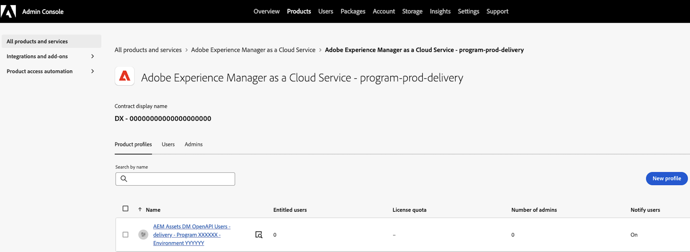

# Permisos de usuario e IMS

**IMS** (Adobe Identity Management System) es la capa de autenticación.

* Para Adobe Commerce as a Cloud Service, el administrador habilita la autenticación IMS de forma predeterminada.
* Para Adobe Commerce en la nube o local, IMS es opcional.

  [Al habilitar IMS para Commerce](https://experienceleague.adobe.com/es/docs/commerce-admin/start/admin/ims/adobe-ims-config){target=_blank}, se proporciona una interfaz de usuario de configuración mejorada con el Selector de recursos y los menús desplegables de entorno y dominio. Si su configuración muestra **ID de programa** y **ID de entorno** por separado, puede introducir esos identificadores manualmente sin IMS.

Al utilizar IMS, la integración de AEM Assets también requiere **perfiles de producto de Adobe Admin Console** específicos. Los usuarios que configuran la integración en Commerce Admin necesitan el perfil de producto **Usuarios de DM OpenAPI AEM Assets - entrega** o el perfil de producto **autor** como reserva. Este acceso se controla mediante perfiles de producto de Admin Console en la organización IMS del usuario y permite lo siguiente:

* **Selector de recursos** le permite seleccionar imágenes de AEM Assets al administrar imágenes de categoría o contenido de Page Builder.
* **Campos de configuración rellenados automáticamente**, incluidos los menús desplegables **Entorno de AEM** y **Asignación de dominios de AEM**, que extraen valores de la sesión IMS del usuario. Consulte [Configurar la integración](setup-synchronization.md) para la selección del entorno y la entrada de ID manual.

Sin los permisos correctos, el Selector de recursos no está disponible y estos campos aparecen vacíos o requieren una entrada manual.

>[!IMPORTANT]
>
> Los perfiles de producto de Adobe Admin Console controlan el acceso de los usuarios a las funciones de integración; no cambian los derechos de licencia. La asignación de un perfil de producto de autor no concede a los AEM Assets acceso a la API de autor a los clientes de Product Visuals. Consulte [Límites de imágenes de producto](../../optimizer/boundaries-limits.md#product-visuals-limits) para conocer los requisitos de derechos.

>[!BEGINSHADEBOX]

**Interacción de IMS y permisos**

Adobe IMS proporciona la identidad del usuario y el contexto de la organización, mientras que Adobe Admin Console define qué **perfiles de producto** (permisos) tienen. La integración de AEM Assets utiliza los detalles de IMS más el perfil asignado para determinar si puede rellenar automáticamente los campos de configuración y habilitar el selector de recursos.

>[!ENDSHADEBOX]

## Por qué se requieren perfiles de producto

La integración solo puede cargar dominios asignados a un perfil. Por lo tanto, los usuarios pueden tener los siguientes perfiles de producto:

* **Perfil del producto de entrega de AEM**. Necesario para el Selector de recursos y la IU de configuración cuando el usuario tiene perfiles de autor y de envío. La integración utiliza el perfil de producto de entrega de AEM cuando está disponible.

* **Perfil del producto del autor**. Necesario para acceder a la interfaz de usuario de AEM Assets. También sirve como alternativa para el Selector de recursos y la IU de configuración cuando el usuario no tiene el perfil de producto de entrega de AEM en su Admin Console.

La integración carga entornos y asignaciones de dominio desde el **perfil de producto de envío de AEM** cuando está disponible, o vuelve al **perfil de producto de autor** cuando el perfil de producto de envío de AEM no está en el Admin Console del usuario. Los usuarios necesitan uno de estos perfiles para:

* Rellene los menús desplegables **Entorno de AEM** y **Asignación de dominios de AEM** en la configuración de administración de Commerce.
* Utilice el Selector de recursos para examinar y seleccionar recursos de los AEM Assets.

Si ninguno de los perfiles está configurado, el Selector de recursos no está disponible. Si su configuración muestra **ID de programa** y **ID de entorno** por separado, puede introducir los identificadores manualmente.

## Conceder permisos por tipo de implementación

>[!BEGINTABS]

>[!TAB Adobe Commerce as a Cloud Service]

[!BADGE Solo SaaS]{type=Positive tooltip="Solo se aplica a los proyectos de Adobe Commerce as a Cloud Service y Adobe Commerce Optimizer (infraestructura de SaaS administrada por Adobe)."}

El sistema habilita la autenticación IMS de forma predeterminada.

Agregue el usuario al perfil de producto **Usuarios de OpenAPI de DM de AEM Assets - delivery** en el perfil de producto [Adobe Admin Console](https://adminconsole.adobe.com/), o al perfil de producto **author** como reserva.

>[!NOTE]
>
> Los usuarios también deben añadirse a Commerce y a los AEM Assets. Consulte [Agregar un usuario a AEM Assets o a elementos visuales del producto](https://experienceleague.adobe.com/es/docs/commerce/cloud-service/user-management#add-a-user-to-aem-assets-or-product-visuals){target=_blank} en la guía de _Usuario y Identity Management_ para obtener la configuración completa.

{width="600" zoomable="yes"}

>[!TAB Adobe Commerce en la nube o local]

[!BADGE Solo PaaS]{type=Informative tooltip="Solo se aplica a proyectos de Adobe Commerce en la nube (infraestructura PaaS administrada por Adobe)."}

Se requiere el **ID de cliente de IMS** para que PaaS habilite el Selector de recursos. Consulte [Configuración del proyecto de AEM Assets](configure-aem.md#prerequisites) para conocer los requisitos previos, incluido cómo obtener el ID de cliente de IMS al habilitar Dynamic Media con OpenAPI.

Para usar el Selector de recursos y los menús desplegables **Entorno de AEM** y **Asignación de dominios de AEM**:

1. [Habilite Adobe IMS para Commerce](https://experienceleague.adobe.com/es/docs/commerce-admin/start/admin/ims/adobe-ims-config){target=_blank} para que el administrador de Commerce utilice la autenticación IMS y pueda leer los perfiles de producto de Admin Console del usuario.

1. Para solicitar un identificador de cliente IMS personalizado para el Selector de recursos, [Abra un ticket de soporte](https://experienceleague.adobe.com/es/docs/support-resources/adobe-support-tools-guide/adobe-commerce-support/adobe-commerce-help-center-user-guide#support-case).

1. Desde [Adobe Admin Console](https://adminconsole.adobe.com/), agregue el usuario al perfil de producto **Usuarios de OpenAPI de DM AEM Assets - delivery** o al perfil de producto **author** como reserva.

Para configuraciones que muestran campos ID de programa e ID de entorno independientes, la entrada manual está disponible sin IMS. Consulte [Configurar la integración](setup-synchronization.md).

>[!ENDTABS]

## Documentación relacionada

* [Configuración de permisos de usuario de IMS para la integración de AEM Assets](setup-synchronization.md): conecte Commerce a los AEM Assets y configure las reglas coincidentes.
* [Selección manual de recursos](../synchronize/asset-selector-integration.md): utilice el Selector de recursos para imágenes de categoría y Page Builder.
* [Agregar un usuario a AEM Assets o a elementos visuales del producto](https://experienceleague.adobe.com/es/docs/commerce/cloud-service/user-management#add-a-user-to-aem-assets-or-product-visuals){target=_blank}: para [!DNL Adobe Commerce as a Cloud Service], primero agregue usuarios a Commerce y a AEM Cloud Manager (Propietario del negocio, Administrador de implementación). El perfil **Usuarios de DM OpenAPI de AEM Assets - delivery** (o el perfil **author** como reserva) es un requisito adicional para el Selector de recursos y las funciones de rellenado automático.
* [Asignar integrantes del equipo a la capa de entrega de AEM](https://experienceleague.adobe.com/es/docs/experience-manager-cloud-service/content/onboarding/journey/assign-profiles-aem#add-team-members){target=_blank}. Documentación de AEM para el acceso a envíos.

