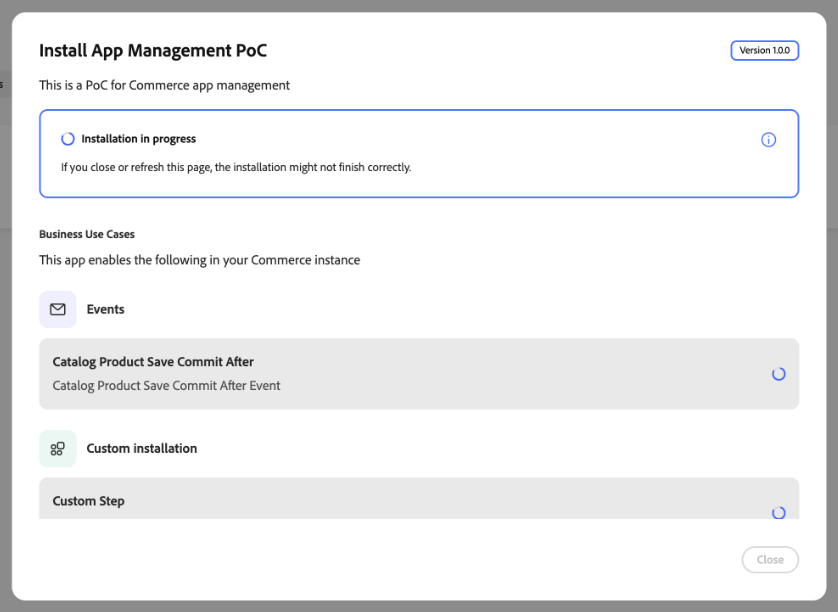

# Administre su aplicación

Use [!DNL App Management] para asociar, instalar, configurar, actualizar y desasociar aplicaciones de App Builder con su instancia de Commerce. Los formularios de configuración se generan a partir del esquema de cada aplicación, para que pueda administrar la configuración sin desarrollar la IU de administración personalizada.

{width="500" zoomable="yes"}

## Buscar una aplicación en el administrador

En **[!UICONTROL Apps]** > **[!UICONTROL App Management]**, cada aplicación aparece como una tarjeta. La lista puede incluir todas las aplicaciones asociadas con la instancia de Adobe Commerce para la organización IMS de Adobe seleccionada. Utilice los controles situados encima de las tarjetas para reducir los resultados:

| Control | Descripción |
| --- | --- |
| **[!UICONTROL Filter by app...]** | Buscar por nombre de aplicación. |
| **[!UICONTROL Status]** | Limitar tarjetas por estado de ciclo vital. **[!UICONTROL All Statuses]** muestra cada aplicación; otros valores incluyen **[!UICONTROL Associated]**, **[!UICONTROL Installed]**, **[!UICONTROL Partially Installed]** y **[!UICONTROL Unassociated]**. El estado de cada tarjeta coincide con el indicador de color de la lista. |
| **[!UICONTROL Extensibility patterns]** | Limite las tarjetas según las capacidades que utilice la aplicación. **[!UICONTROL All Extensibility Patterns]** muestra cada aplicación; otros valores se alinean con los distintivos de cada tarjeta, como **[!UICONTROL Business Configuration]**, **[!UICONTROL Admin UI SDK]**, **[!UICONTROL Webhooks]** y **[!UICONTROL Events]**. |

El campo de búsqueda y ambos filtros se aplican juntos. Para volver a mostrar la lista completa, borre el campo de búsqueda y seleccione **[!UICONTROL All Statuses]** y **[!UICONTROL All Extensibility Patterns]**.

### Revisar detalles de la aplicación

En la tarjeta de la aplicación, seleccione **[!UICONTROL Manage]** > **[!UICONTROL Details]** para revisar su nombre, descripción y versión. El cuadro de diálogo proporciona dos pestañas:

* **[!UICONTROL Details]** enumera los casos de uso empresariales de la aplicación, incluidos los eventos y los pasos de instalación personalizados. Revise las etiquetas y las descripciones para comprender lo que la aplicación añade a Commerce.
* **[!UICONTROL App config]** muestra la configuración de la aplicación como JSON para inspección.

{width="600" zoomable="yes"}

{width="600" zoomable="yes"}

## Adquirir aplicación

**[!UICONTROL Acquire App]** abre una nueva ficha de explorador (o una vista de explorador independiente) en [Adobe Exchange](https://exchange.adobe.com/apps/browse/ec){target="_blank"}, donde podrá detectar anuncios de Marketplace relacionados con Commerce y agregar aplicaciones a su organización de IMS. Una vez adquirida, aprobada e implementada la aplicación, esta aparece en [!DNL App Management] para [association](#associate-an-app) e [installation](#install-an-app).

## Requisitos previos

Antes de asociar una aplicación, asegúrese de que dispone de lo siguiente:

| Requisito | Descripción |
| --- | --- |
| **Acceso de administrador** | Administrador de Commerce con permisos para [!DNL App Management] |
| **Aplicación implementada** | Aplicación de App Builder implementada en su organización y lista para conectarse |
| **Acceso a la organización** | Acceso a la organización de Adobe donde se implementa la aplicación |

## Tutorial

Vea este vídeo para aprender a asociar una aplicación a una instancia de Commerce y configurar opciones.

>[!VIDEO](https://video.tv.adobe.com/v/3478958?captions=spa)

## Asociar una aplicación

El proceso de asociación importa sitios web, tiendas y vistas de tiendas desde Commerce y crea el vínculo entre la aplicación y la instancia de Commerce.

Para vincular la aplicación de App Builder a una instancia de Commerce:

1. Vaya a **[!UICONTROL Apps]** > **[!UICONTROL App Management]**.

1. Haga clic en **[!UICONTROL Associate App]**.

   {width="500" zoomable="yes"}

1. Seleccione un(a) **[!UICONTROL Project]** de la lista.

1. Seleccione **[!UICONTROL Workspace]**.

1. Haga clic en **[!UICONTROL Associate]**.

   {width="500" zoomable="yes"}

>[!WARNING]
>
>Si la sincronización del ámbito falla, la asociación se completa. Puede sincronizar los ámbitos manualmente más adelante desde la vista **[!UICONTROL Manage Scopes]** en la configuración de la aplicación asociada.

## Instalación de una aplicación

La asociación vincula una aplicación a su instancia de Commerce. En el caso de las aplicaciones que incluyen componentes instalables, como eventos, webhooks, extensiones de la IU de administración o pasos de instalación personalizados, la instalación aplica esos componentes a la instancia.

1. Abra el cuadro de diálogo de instalación de la aplicación asociada en [!DNL App Management].

1. Revise los casos de uso empresariales de la aplicación y los pasos de instalación enumerados.

1. Si se muestran **[!UICONTROL Pre Installation Instructions]**, complete esos requisitos previos antes de continuar.

   {width="600" zoomable="yes"}

1. Haga clic en **[!UICONTROL Install]**.

1. Supervise los indicadores de progreso de los elementos individuales hasta que finalice la instalación.

   {width="600" zoomable="yes"}

   >[!WARNING]
   >
   >Mantenga la página abierta hasta que finalice la instalación. Si cierra o actualiza la página, es posible que la instalación no se complete correctamente.

1. Compruebe que se muestre **[!UICONTROL Successfully Installed]** y que los elementos completados tengan marcas de verificación.

   {width="600" zoomable="yes"}

1. Complete las instrucciones posteriores a la instalación proporcionadas por la aplicación y, a continuación, [configure sus opciones](#configure-settings) según sea necesario.

## Configurar opciones

Después de asociar una aplicación en la vista [!DNL App Management], configure su configuración mediante el formulario:

1. En la tarjeta de la aplicación asociada, seleccione **[!UICONTROL Manage]** > **[!UICONTROL Configure]**.

El formulario muestra la configuración de la aplicación.

1. Modifique los valores según sea necesario.

1. Haga clic en **[!UICONTROL Save]**.

### Configuración específica del ámbito

Utilice una configuración específica del ámbito cuando diferentes sitios web, tiendas o vistas de tiendas necesiten una configuración única. Por ejemplo, habilite una función solo para una región o vista de tienda específica, o use diferentes configuraciones por marca. La configuración de un ámbito inferior anula la de los ámbitos superiores.

Para anular los valores globales en un nivel de ámbito específico:

1. Haga clic en **[!UICONTROL Change Scope]**.

1. Seleccione un ámbito de la lista.

1. Modifique los valores de este ámbito.

1. Haga clic en **[!UICONTROL Save]**.

## Administrar ámbitos

Acceda a **[!UICONTROL Manage Scopes]** desde la pantalla de detalles de la aplicación para administrar la jerarquía de ámbito de la aplicación.

{width="500" zoomable="yes"}

| Acción | Descripción |
| --- | --- |
| **[!UICONTROL Add root scope]** | Agregue un ámbito que se aplique únicamente a la aplicación. |
| **[!UICONTROL Sync Commerce scopes]** | Actualice la lista de sitios web, tiendas y vistas de tiendas desde Commerce después de agregarlos o cambiarlos. |
| **[!UICONTROL Import scopes]** | Importar ámbitos de forma masiva desde un archivo. |

## Actualizar una aplicación

Cuando el desarrollador de aplicaciones implementa una nueva versión de una aplicación instalada, [!DNL App Management] recibe una notificación avisando que hay una actualización disponible. La implementación de App Builder y una actualización de la Administración de aplicaciones son operaciones independientes: la actualización aplica los cambios planeados a los componentes instalados, como eventos, enlaces web y extensiones de la IU de administración.

Pida al desarrollador de aplicaciones que confirme que la aplicación admite actualizaciones. Para conocer los requisitos previos de SDK y los requisitos de migración, consulte [Actualizar la aplicación](https://developer.adobe.com/commerce/extensibility/app-management/upgrade-app/){target="_blank"} en la documentación para desarrolladores.

### Revisión e inicio de una actualización

En el modo manual, que es el predeterminado, se revisa e inicia la actualización en [!DNL App Management].

1. Registre la versión y configuración de la aplicación instalada, y haga una copia de seguridad de los datos de la aplicación y los recursos externos con la ayuda del desarrollador de la aplicación.

1. Vaya a **[!UICONTROL Apps]** > **[!UICONTROL App Management]** y abra la actualización disponible para la aplicación.

1. Revise los cambios planificados y las advertencias. Una actualización puede agregar, modificar o quitar componentes. Si se quita un paso de instalación personalizada, no se ejecuta el script de desinstalación y los recursos que ha creado no se limpian automáticamente. Antes de continuar, confirme con el desarrollador de aplicaciones la limpieza necesaria.

1. Inicie la actualización y monitorice el progreso de las operaciones enumeradas.

1. Revise el resultado de la actualización y compruebe si hay operaciones fallidas. Si la actualización falla, siga [La actualización falla](troubleshooting.md#upgrade-fails) antes de usar **[!UICONTROL Retry Upgrade]**.

En el modo manual, los cambios planificados en los componentes de Commerce instalados no se aplican hasta que se inicia la actualización. Sin embargo, la implementación puede actualizar el código de acción en tiempo de ejecución que la aplicación instalada ya utiliza antes de que se ejecute la actualización.

### Actualizaciones automáticas

El desarrollador de aplicaciones controla el modo de actualización. Pida al desarrollador que confirme si la aplicación utiliza actualizaciones manuales o automáticas.

>[!WARNING]
>
>Las actualizaciones automáticas son experimentales y se inician después de la implementación sin revisión del administrador, incluidos los scripts de instalación personalizados que pueden modificar los recursos externos. Póngase en contacto con el desarrollador antes de habilitar las actualizaciones automáticas, incluso cuando una versión recién implementada cambie el modo de manual a automático.

### Cambios en la configuración empresarial

Los cambios en el esquema de configuración empresarial de la aplicación aparecen automáticamente después de la implementación. Son independientes de la instalación y las actualizaciones y no almacenan en déclencheur una actualización de la aplicación.

## Desasociar una aplicación

Cancele la asociación de una aplicación cuando ya no la necesite conectada a su instancia de Commerce. Por ejemplo, es posible que tenga que retirar una integración, cambiar a un espacio de trabajo diferente o limpiar las configuraciones de prueba.

>[!WARNING]
>
>Al desasociar, se eliminan todos los valores de configuración de esta instancia. Esta acción no puede deshacerse. La desinstalación también puede eliminar componentes y recursos de la aplicación mediante scripts de desinstalación personalizados.

Antes de continuar, registre la versión y configuración instaladas, haga una copia de seguridad de los datos de la aplicación y pregunte al desarrollador de la aplicación qué recursos eliminan los scripts de desinstalación de la aplicación y cuáles requieren limpieza manual. Planifique cualquier interrupción del servicio y cómo restaurar la aplicación, su configuración y sus datos. Para actualizaciones de rutina, [actualiza la aplicación](#upgrade-an-app) en lugar de desasociarla.

Para eliminar una aplicación de una instancia de Commerce:

1. Vaya a **[!UICONTROL Apps]** > **[!UICONTROL App Management]**.

1. En la tarjeta de la aplicación, seleccione **[!UICONTROL Manage]** > **[!UICONTROL Unassociate]**.

1. Revise los casos de uso empresariales enumerados y los componentes afectados por la desinstalación, incluidos los eventos y los pasos de instalación personalizados.

   {width="600" zoomable="yes"}

1. Confirme la acción.

## Documentación relacionada

* [Solución de problemas [!DNL App Management]](troubleshooting.md) - Resuelva problemas comunes con la asociación, instalación, configuración y actualizaciones.
* [Actualice la aplicación](https://developer.adobe.com/commerce/extensibility/app-management/upgrade-app/){target="_blank"}: requisitos para desarrolladores para modos de actualización, scripts de migración y diagnósticos.
