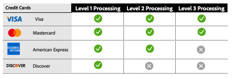

# Procesamiento de los niveles 2 y 3

[!DNL Payment Services] ofrece capacidades avanzadas de procesamiento de tarjetas para ayudar a los comerciantes a optimizar sus transacciones de pago y reducir las tarifas de intercambio. Hay tres niveles de procesamiento de tarjetas disponibles, cada uno con diferentes requisitos de datos de transacción.

>[!CAUTION]
>
> Los pedidos de [carril rápido](payments-options.md#fastlane-button) no incluyen datos de nivel 2/nivel 3, elementos de línea y desglose de cantidades.

## Requisitos de datos por nivel de procesamiento

{width="500" zoomable="yes"}

[!DNL Payment Services] recopila estos datos y proporciona un informe detallado de sus transacciones de pago.

## Niveles de procesamiento disponibles por red de tarjetas

{width="500" zoomable="yes"}

Consulta [procesamiento de pagos](https://developer.paypal.com/docs/checkout/advanced/processing/){target=_blank} en la documentación para desarrolladores de PayPal para obtener más información.

### Nivel 1

El nivel 1 es el más común, requiere menos información y, por lo tanto, en general incurre en tasas de intercambio más altas en comparación con las transacciones procesadas con datos de nivel 2 o nivel 3, que suelen estar relacionadas con tarjetas de crédito corporativas y de compra.

### Nivel 2 y nivel 3

Los comerciantes de [!DNL Payment Services] en Interchange Plus (IC++) pueden cumplir los requisitos para el procesamiento de nivel 2/nivel 3 si proporcionan detalles de transacción adicionales a las redes de tarjetas y cumplen con los criterios de calificación específicos. Estos niveles son especialmente beneficiosos para los comerciantes que gestionan volúmenes significativos de tarjetas corporativas o de compra, ya que pueden suponer un ahorro significativo en los costes. Suministrar datos detallados de los niveles 2 o 3 puede:

* Reducción de las tasas de procesamiento y optimización de los costes generales
* Prevención del fraude, reducción del riesgo del procesador
* Mejora de la seguridad de transacciones

Ver [Qué es IC++?](https://www.paypal.com/us/brc/article/what-is-interchange-plus-plus){target=_blank} en la documentación para desarrolladores de PayPal para obtener más información.

## Transacciones de pago con tarjeta de nivel 2 y nivel 3 en [!DNL Payment Services]

Para ser apto para el procesamiento de nivel 2 o nivel 3, los comerciantes deben enviar la información anterior, aunque son las redes de tarjetas las que finalmente determinan para qué nivel se califica una transacción al procesarla.

Consulta las [Preguntas frecuentes sobre el procesamiento de pagos](https://www.paypal.com/us/cshelp/article/ts2278?_ga=1.131773126.875104296.1712843492){target=_blank} en la documentación para desarrolladores de PayPal para obtener más información.

El procesamiento de nivel 2 y nivel 3 está deshabilitado de manera predeterminada para [!DNL Payment Services] comerciantes en el nivel de tienda.

El procesamiento de los niveles 2 y 3 está disponible si ya utiliza los precios de IC++. Para habilitar esta característica, puede hacerlo mediante la [Interfaz de línea de comandos (CLI](configure-cli.md)).

>[!IMPORTANT]
>
>Si tiene alguna pregunta, comuníquese con el administrador de cuentas de [!DNL Payment Services].
