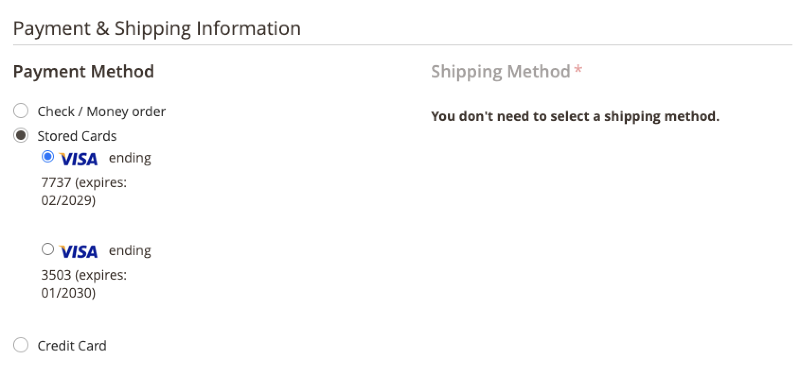

# Bóveda de tarjeta de crédito

Convierta a los compradores únicos en clientes fieles con depósito de tarjetas de crédito. Los clientes que iniciaron sesión pueden guardar (o &quot;guardar&quot;) las credenciales de su tarjeta de crédito para usarlas en una compra posterior para la misma tienda, u otra, dentro de la misma cuenta de comerciante.

## Activar almacenamiento en depósito

Los comerciantes pueden habilitar el almacenamiento de tarjetas de crédito en sus tiendas en [!DNL Payment Services] [Configuración](configure-admin.md#card-vaulting).

1. En la barra lateral _Admin_, vaya a **[!UICONTROL Sales]** > **[!UICONTROL Payment Services]**.

1. Haga clic en **[!UICONTROL Settings]**.

1. Alterne el selector **[!UICONTROL Vault enabled]**. Consulte [Habilitar [!DNL Payment Services]](configure-admin.md#enable-payment-services) para obtener más información.

## Bóveda sin compra

Los clientes que iniciaron sesión pueden proteger un método de pago en el panel **Mi cuenta** al:

1. Iniciando sesión en su **Mi cuenta** en la tienda.

1. Vaya a **[!UICONTROL Stored Payment Methods]** en el panel de navegación izquierdo para ver todos sus métodos de pago almacenados.

   Consulte [Métodos de pago almacenados](https://experienceleague.adobe.com/en/docs/commerce-admin/stores-sales/payments/stored-payment-methods) para obtener más información.

1. El cliente hace clic en **[!UICONTROL Add New Card]** para almacenar una tarjeta nueva.

   {width="400" zoomable="yes"}

   El cliente debe proporcionar todos los detalles necesarios, como la información de la tarjeta y la facturación, para proteger el método de pago.
   Todos los métodos de pago abovedados utilizan la dirección de facturación establecida al depositar la tarjeta, que se encuentra en la cuenta PayPal del comprador. Es posible que el cliente vea una dirección de facturación diferente a la que se muestra en Commerce.

1. Haga clic **[!UICONTROL Save New Card]**

   {width="400" zoomable="yes"}

Las tarjetas almacenadas son elegibles para su uso al realizar un pedido:

{width="400" zoomable="yes"}

### Eliminar un método de pago almacenado

Los clientes pueden eliminar fácilmente las tarjetas de crédito abovedadas de los **Métodos de pago almacenados** en la **Mi cuenta** haciendo clic en **Eliminar** para una tarjeta específica.

## Abonos de una forma de pago durante el pago

Los clientes que iniciaron sesión pueden guardar una tarjeta de crédito durante el cierre de compra para usarla en una compra posterior en la tienda actual o en otras tiendas de la misma cuenta de comerciante:

{width="400" zoomable="yes"}

Commerce almacena un token que ayuda a los clientes a realizar cierres de compra futuros mediante la obtención de la información de su tarjeta de crédito guardada. Al depositar una tarjeta en la cuenta del cliente o durante el cierre de compra, se generarán distintos tokens de pago.

>[!WARNING]
>
> PayPal puede almacenar actualmente un máximo de cinco tarjetas abovedadas.

## Uso del Vault en la administración

Si un cliente tiene una tarjeta de crédito previamente seleccionada, un comerciante puede crear un pedido posterior para ese cliente en la administración mediante cualquiera de estos métodos de pago abovedados.

Solo puede utilizar tarjetas abovedadas en el administrador si el cliente tiene una cuenta existente y un token válido almacenado en el sistema a partir de un pago completado anteriormente.

Para crear un pedido en Admin para un cliente con su tarjeta de crédito:

1. [Crear un pedido y agregar productos](https://experienceleague.adobe.com/en/docs/commerce-admin/stores-sales/point-of-purchase/assist/customer-account-create-order).
1. En _[!UICONTROL Payment & Shipping Information]_, seleccione **[!UICONTROL Stored Cards]**&#x200B;como método de pago.
1. Seleccione el método de pago de tarjeta de crédito abovedado que desee.
1. Después de completar cualquier otro paso necesario para el pedido, [envíelo](https://experienceleague.adobe.com/en/docs/commerce-admin/stores-sales/point-of-purchase/assist/customer-account-create-order?lang=en#step-3%3A-submit-the-order).

   {width="600" zoomable="yes"}

## Seguridad

La información mínima de la tarjeta de crédito se comparte con el comprador; solo ve los últimos cuatro dígitos, la fecha de caducidad y la marca de su tarjeta de crédito abovedada. La información de la tarjeta de crédito se almacena con el proveedor de pagos para cumplir con los estándares de cumplimiento de [PCI](security.md#pci-compliance).
